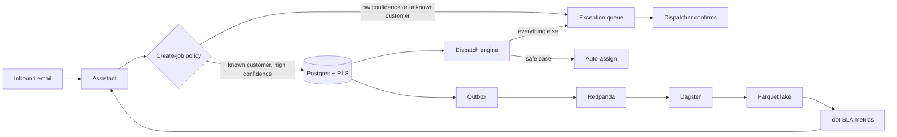

# Fieldkit

Fieldkit is the dispatch system for a field-service company. An inbound email becomes a job, a scoring engine assigns the safe ones, and a dispatcher sees only the jobs that need a person. Two companies can run on the same deployment. Postgres row-level security keeps their customers, sites, and jobs apart.

The weekly number on the dashboard is computed in the warehouse from domain events. When someone asks what percent of jobs were auto-assigned, the assistant reads that figure. It does not invent one.

## How a job is decided

An email or text arrives. The assistant returns a draft: customer, site, skill, urgency, and a confidence score.

| Draft | What happens |
|---|---|
| High confidence, customer already on file | Policy creates the job. It is still unassigned. |
| Garbled text, unknown customer, or low confidence | The draft waits on the exception queue. |

The engine then ranks technicians for that job.

- Skill match
- Shift coverage
- Coarse travel distance
- Jobs already on the technician
- Part present on the van
- Time left on the SLA clock

The board always shows the top three for jobs a person must touch. An easy job is one where every check is true: known customer, skill matched, wide score gap, part on the van, site ready, the visit fits the shift, and the job is not VIP, emergency, or a suspected duplicate. Policy assigns those on its own. Every other job stays on the exception queue. The dispatcher corrects the draft or confirms a technician from the top three. That confirmation is audited.

dbt counts `jobs_completed`: jobs that reached `completed` in the window, by company and by job type. The assistant reads that count with `get_metric`.

The assistant has no tool that assigns a technician. Auto-assign is the policy above, running in the dispatch engine.

A Redis lock covers the assign path, so two dispatchers cannot take the same job. Ingest and assign accept an idempotency key.

## Events and the weekly number

A job change and its domain event commit together through an outbox. The event names are `created`, `scored`, `auto_assigned`, `exception_opened`, `assigned`, `started`, `completed`, `sla_breached`, and `replanned`. A publisher delivers the outbox to Redpanda. Dagster loads new events into Parquet. dbt builds the SLA models from that lake, incrementally.

Percent auto-assigned, for a time window:

```text
auto_assigned / (auto_assigned + manually_assigned + still_open)
```

`still_open` counts jobs in the window that have not been assigned. The dashboard and the assistant both use this model.

## Assistant

The assistant is a clerk with a fixed set of tools.

- Draft a job from an email or text.
- `get_metric` for a warehouse figure, including percent auto-assigned and the SLA measures.
- `list_jobs_in_exception_queue`
- `explain_score` for the engine's factor breakdown on a job.

There is no text-to-SQL tool. A golden set in CI checks tool choice and the returned numbers. A wrong tool, a made-up percent, or an assignment call fails the build.

## Tenancy

Application tables carry `tenant_id`. The API connects as a role that does not own those tables and does not bypass row-level security. Each transaction sets `app.tenant_id` locally. If the setting is missing, the policies return no rows. The isolation test connects as that role and proves tenant A cannot read tenant B, including by primary key, with no tenant filter in the query.

## Deployment

Terraform is the source of truth for Azure: the app, PostgreSQL, Key Vault, blob storage, Event Hubs, the worker, and HTTPS. Secrets live in Key Vault. GitHub Actions runs the unit tests, the RLS isolation test, the dbt tests, and the assistant golden set. A red check does not deploy.

## System



## Roadmap

The pieces above are the product. These are planned additions, in order. Each one is additive: the dispatch engine still assigns, and every warehouse number still comes from dbt.

**Constraints in the engine**

- Service area: crew territory polygons in PostGIS. A site outside the territory goes to the exception queue as `outside_service_area` before scoring runs, and the same geometry sharpens the travel factor.
- Weather: a severe-conditions feed raises travel time and SLA risk in the score. The assistant can explain the change; it does not make it.
- Replan on a missing part: order the part, hold the job, re-score when van stock changes, and emit `replanned`.

**Intake**

- Email, SMS, and new-activation forms produce the same draft shape, with the same confidence rule and audit trail.
- New-customer drafts auto-save only on a strong identifier match. A fuzzy name match goes to a human, because a wrong customer is a billing and privacy incident.
- Duplicate detection compares a new draft against recent jobs at that site. A suspected repeat opens an exception rather than merging silently.

**Model features grounded in our own history**

- Parts suggestion from the complaint text, checked against van stock by the engine, measured against first-visit fix rate.
- SOP retrieval over procedure PDFs with page citations, for technicians on site. Procedure text only.
- Post-job notes turned into structured history: what failed, what was replaced, time spent.
- Customer reply drafts for appointment windows and delays.
- Metric narration: the warehouse supplies the figure, the assistant groups exception reasons and describes the trend.

**Where the crew should spend the day**

- Readiness: a job is scored only after its checks pass (permit cleared, prerequisite done, access open, material on site). A failed check waits in the exception queue as `site_not_ready`. That list is "which points are ready to connect."
- Crew-day plan: the engine orders ready jobs against skills, travel, SLA, and crew hours. The written objective is more finished jobs, shorter travel, short SLAs first. The assistant explains the order.
- Where to focus: dbt counts ready and blocked work by zone. The assistant describes that figure. A customer reply says why the visit is waiting and when it can proceed. A person or a policy sends it.
- RAG: procedure pages are retrieved with pgvector and cited in the answer. The answer is procedure text. Counts, readiness, and assignment stay outside retrieval.

**How long it takes**

- A repair and a new activation are the same kind of job, with `job_type` set to `repair` or `new_activation`. A new activation still waits until the site is ready, and the engine still assigns the technician.
- dbt computes `median_visit_minutes` from finished jobs of the same type and skill (`completed_at` minus `started_at`). The engine uses it to see if the visit fits the shift.
- The customer message quotes that median and the arrival window only when enough similar jobs exist. A thin history says a person will confirm the time. The model does not make up the minutes.

## Stack

Python 3.12, FastAPI, SQLAlchemy 2, Alembic, PostgreSQL 16, PostGIS, Redis, Redpanda, dbt, Dagster, React, Azure OpenAI, Terraform.
